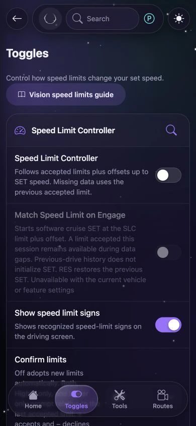

# Speed Limit Controller

The Speed Limit Controller, or SLC, uses the accepted speed limit plus a configurable offset. SET is your cruise ceiling. SLC can cap the target below SET. Accepting a posted limit normally leaves SET where it is.

SLC does not replace the driver's judgment. Speed-limit information can be missing, delayed, or incorrect. Always follow posted signs and adjust the set speed when needed.

## Enable SLC

In Galaxy, open **Toggles → Longitudinal (Speed & Following) → Speed Limit Controller**.
**Show speed limit signs** displays available readings. Enable **Speed Limit Controller** to
use accepted limits with supported StarPilot speed control or Hyundai Redneck Cruise.

??? example "See this in Galaxy: speed-limit controls"

    Open **Toggles → Longitudinal (Speed & Following) → Speed Limit Controller**.
    The controller and sign-display switches are separate controls.

    [{ .galaxy-screenshot width="390" height="844" loading="lazy" }](../assets/images/galaxy/speed-limit-controller.webp)

    *Disabled controls can depend on your vehicle or other settings. The values shown are an example, not recommended settings. Tap the image to open it full size.*

## Driving-screen colors

The speed-limit sign displays the limit and indicates when a new reading needs confirmation. A green outline indicates active limiting where shown. **OVERRIDE** indicates that an override is active. The cruise SET display still shows the driver’s ceiling.

## Speed-limit sources

SLC can use the following sources:

* **Dashboard** reads a speed limit supplied by a supported vehicle.
* **Maps** uses installed [Speed Limit Maps](./navigation.md#offline-maps) for the current road.
* **Vision** uses the road camera to detect speed-limit signs.

Use **Primary source**, **Secondary source** and **Third source** to choose which sources
SLC can use. Set either optional source to **Off** to disable it. SLC offers the most
recently changed valid limit. Source order breaks ties when limits change together.

### Vision speed limits

Choose **Vision** in any of the three source fields where available. Check camera-reported limits against road signs. Vision can misread signs, so keep another source available and use **Confirm limits** when evaluating it. To help improve detection, see [Vision Speed Limit Detection](../usage/operation.md#vision-speed-limit-detection).

## Configure speed offsets

The offset editor lets you set a separate adjustment for each of seven posted-speed bands. Use the bands and units shown in Galaxy. A positive offset raises the adjusted limit and a negative offset lowers it.

For example, with SET at 65 mph and an accepted limit of 50 mph plus a 5 mph offset, SLC caps the target at 55 mph. SET stays at 65 mph.

## Confirm new speed limits

Use **Confirm limits** to choose **Off**, **Both**, **Higher only** or **Lower only**. Off adopts new readings automatically.

When a prompt is active, press **+** to accept or **−** to decline within 30 seconds. You can also tap the sign to open the decision controls. A prompt that times out leaves the new limit unaccepted.

## Look ahead for changes

Use **Adopt higher limits early** and **Adopt lower limits early** for upcoming changes in map data. Each setting can be **Off** or set to 1–10 seconds. Lookahead depends on available map data.

## Match the limit when engaging

**Match Speed Limit on Engage** can initialize SET to the adjusted speed limit when you engage. Use **RES** to restore the previous SET speed where supported. An ordinary limit accepted later still caps the target below SET without changing it.

On supported Hyundai setups using **Redneck Cruise**, pressing **SET** to engage can lower
the new SET speed to the adjusted limit. The adjusted limit must be within the vehicle's
cruise range and below the new SET speed.

## When a reading is unavailable

A source going quiet leaves SLC waiting for a changed reading. An accepted limit can
remain in effect, bounded by SET. If there is no accepted limit, ordinary SET behavior applies.

## Override SLC

Use **After an accelerator override** to choose what happens when you release the accelerator:

* **Resume the adjusted limit** returns to the adjusted speed limit.
* **Hold the speed you reached** keeps the speed you reached, bounded by SET.
* **Use your SET speed** lets SET govern the target.

On supported configurations, **Override speed limit with +** lets the cruise increase button
raise SET past the adjusted limit and bypass the cap. When a confirmation prompt is active,
**+** accepts the proposed limit. The posted reading stays the same when you override the cap.

## Show source information

Where available, enable the source display options to compare readings from the dashboard, maps and Vision. A source value is a reading. The accepted limit and its offset are the values SLC uses to cap your target.

## Incorrect or missing map limits

Map-based speed limits come from [OpenStreetMap](https://openstreetmap.org). If a road has an
incorrect or missing limit, correct it in OpenStreetMap. When newer coverage is available,
download it for your region in [Speed Limit Maps](./navigation.md#offline-maps). The updated
coverage is selected for the next Maps service start.

See [Vision Speed Limit Detection](../usage/operation.md#vision-speed-limit-detection) if you want to help improve camera-based sign detection.

> [!TIP] Start conservatively
> Start with confirmation enabled and small offsets. Display the source information while testing so you can see where each limit came from. Change one setting at a time and verify its behavior before relying on it regularly.
