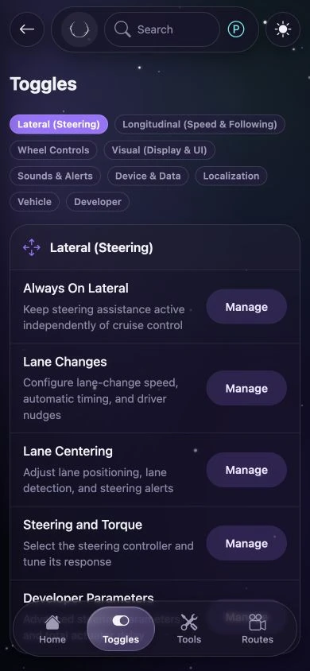
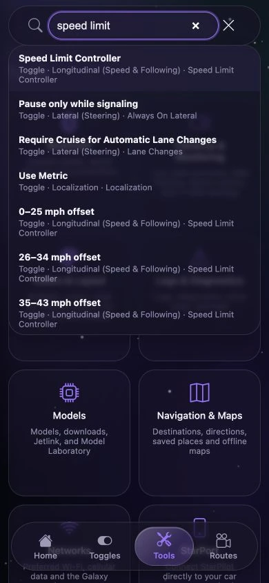
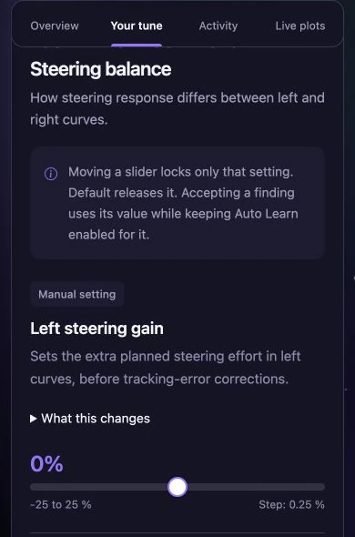

# Configure Settings

The default settings are good for most users and are recommended.
Saved settings may carry between compatible versions, but compatibility across branches and
other forks is not guaranteed. Use Galaxy’s **Toggle backup** to save editable toggles, layout
and colors before switching software.

The below sections highlight settings that might be worth looking at.
If you have trouble finding any settings, use [Galaxy](./galaxy.md)'s toggle search.

??? example "See this in Galaxy: browse settings"

    Tap **Toggles**, choose a category, then tap **Manage** beside the group you need.

    [{ .galaxy-screenshot width="390" height="844" loading="lazy" }](../assets/images/galaxy/toggles.webp)

    *Categories sit above the settings groups in portrait view. Tap the image to open it full size.*

??? example "See this in Galaxy: find a setting with search"

    Tap the search icon and type a feature name. Each result shows its settings category;
    choose the matching result to open that page.

    [{ .galaxy-screenshot width="390" height="844" loading="lazy" }](../assets/images/galaxy/search.webp)

    *Search helps when you know the feature name but not its category. Tap the image to open it full size.*

If behavior feels off or the car drives unexpectedly, 
try resetting your toggles to default or using safe mode.

> [!WARNING] Changing tuning values
> If you’re going to change a value, make small changes within the setting’s allowed range.
> Change one setting at a time and follow vehicle-specific guidance.

> [!TIP] Want to change settings from your phone?
> Use [the Galaxy](./galaxy.md)

Follow each setting’s apply-timing note. A saved choice may take effect on the next drive
or after a restart.

## Safe Mode

Safe Mode temporarily bypasses the custom features and tuning that support it, without
erasing their saved settings. This can help check whether a custom setting is contributing
to unexpected behavior. Its effects depend on the vehicle and feature. Follow any restart
prompt.

## Openpilot Toggles

Enable openpilot to use driver assistance. Speed-control options depend on your vehicle and
setup; follow the guide for your exact configuration.

**Alpha Longitudinal** may appear as **openpilot Longitudinal Control (Alpha)**. Where available,
it requests StarPilot acceleration and braking control for the next drive and may disable
factory Automatic Emergency Braking.

When factory ACC controls speed, StarPilot’s SLC, CSC and Enhanced Stops cannot control speed.

## Sounds & Alerts {#alerts-and-sounds}

Under **Sounds & Alerts**, use **Engagement Chime** and **Disengagement Alert** to adjust those
sounds. **Immediate Warning** and **Soft Warning** retain minimum volume limits.

We do not recommend changing the volume of any important alerts.

**Green Light Alert** chimes when the model’s traffic-light stop prediction clears while you
remain stopped. **Lead Departing Alert** chimes when the tracked vehicle ahead starts moving
while you remain stopped.

## Longitudinal (Speed & Following) {#driving-controls}

### Low-speed cruise start

Under **Toggles → Longitudinal (Speed & Following) → Long Planner**, enable **Low-Speed
Cruise Start** to set StarPilot cruise at your current speed down to the vehicle's minimum
engagement speed. Factory cruise uses the car's own minimum speed.

### Driving Mode and Automatic conditions {#conditional-experimental-mode-recommended}

On Stable, **Driving Mode** offers **Automatic**, **Chill** and **Experimental**. Automatic switches
between Chill and Experimental using your saved conditions.

Open **Automatic conditions** to configure conditions involving speed, curves, lead vehicles,
turn signals and stop lights. **Model stop time** currently defaults to **7.7 seconds**. Start
with the default and check why Automatic activates before adjusting it.

See [Conditional Experimental Mode](./operation.md#conditional-experimental-mode) for Stable
or [Upcoming End to End behavior](./operation.md#end-to-end) for the planned rename.

### Conditional Chill Mode

Older saved CCM selections are handled as Automatic; current controls use **Driving Mode**
and **Automatic conditions**. Read more about CCM
[in the operation guide](./operation.md#conditional-chill-mode).

### Curve Speed Control

Read more about CSC [in the operation guide](./operation.md#curve-speed-controller)

### Customize Driving Personalities

**Custom Following and Jerk** enables saved following-distance and jerk settings for the
driving personalities. Acceleration and deceleration profile selections apply independently.

Switch personalities using the supported following-distance button, on-screen personality
widget or **Cycle Driving Personality** in Quick Select.

For optional Bluetooth or USB controller setup, see the
[Bluetooth guide](../exclusive/bluetooth-controls.md).

#### Upcoming End to End acceleration {#end-to-end-acceleration}

In the upcoming `testingupstreamsync` integration, **Standard** and **Aggressive** are planned
to get the upstream-style model acceleration boost automatically. **Relaxed** will be able
to opt into a nudge with a proposed toggle called **Speed Nudge in Relaxed**.

### Extra stopped-lead distance

**Extra stopped-lead distance** adds space behind slow or stopped lead vehicles with the
StarPilot planner. Zero keeps the normal gap.

This adjusts the gap, not whether StarPilot detects a lead or begins braking in time.

## Wheel Controls

Under **Wheel Controls**, **Short press** and **Hold** configure speed increments where
StarPilot controls cruise SET.

On compatible Toyota setups, **Swap Toyota Cruise Steps** makes a short press change SET
by 5 and a hold by 1, in the selected speed units. Factory cruise-button behavior depends
on the vehicle.

## Lateral (Steering) {#steering}

### Always on Lateral

Under **Lateral (Steering) → Always On Lateral**, **Enable Always On Lateral** keeps steering
assistance available independently of cruise speed control.

Available controls include **Brake pause below**. Button and pedal behavior depends on your
vehicle and settings. See [the Operation guide](./operation.md#always-on-lateral) for armed,
active and paused behavior.

### Lane Changes

**Automatic Lane Changes: Recommended Off.** With this off, nudge the steering wheel after
signaling to begin an assisted lane change.

**Allow lane changes** and **Minimum lane-change speed** govern availability. Automatic
changes use the configured delay and lane/blindspot checks. If **Require Cruise for Automatic
Lane Changes** is enabled, engage cruise before signaling.

> [!WARNING] Stay Aware while Changing Lanes
> Always check your blind spot yourself. Detection depends on the vehicle and available sensor
> information.

### Lateral Tuning

Where supported, **Steering Controller** offers **Stock Controller** and **StarPilot Controller**.
Controller changes apply on the next drive.

Under **Toggles → Lateral (Steering) → Steering & Torque**, **Turn Assist** uses steering-angle
feedback to help with rolling low-speed turns on supported setups. **Automatic Turn
Initiation** lets the model anticipate a signaled intersection turn. It defaults to **Off**.
With it off, start the turn yourself to use Turn Assist.

**Use StarPilot Auto Learn** uses data from your drives to refine torque profiles. Moving a
supported manual slider locks that setting while Auto Learn can continue on the others.
Select **Default** to unlock the setting.

With Auto Learn enabled, park and switch off the vehicle after a drive. Open
**Tools → Tuning and Analysis → Your tune** in local Galaxy and wait for the drive review.
Use **Accept finding** on an eligible finding to save it for the next drive. Check
**Applied now** to see what the controller is using.

??? example "See this in Galaxy: manual tuning and Auto Learn"

    On supported vehicles, open **Tools → Tuning and Analysis → Your tune**, then find **Steering balance** under **Explore your settings**.

    [{ .galaxy-screenshot width="390" height="590" loading="lazy" }](../assets/images/galaxy/tuning-controls.webp)

    *Moving a slider can lock that setting; viewing it does not. This example excludes vehicle details and recorded-drive findings. Do not copy its values as a tune for your car. Tap the image to open it full size.*

For a Discord tuning request, **Prep My Vehicle for Tuning** prepares supported steering
settings before recording a route. Turn it off afterward to restore your previous tuning
preferences.

## Navigation

Open **Galaxy → Tools → Navigation & Maps → Setup**, enable **Navigation**, and save a public
Mapbox token. See [Navigation & Maps](../exclusive/navigation.md) for routes, GPS, and offline
maps.

## Device and display settings

Under **Toggles → Device & System**, open **Power & Cooling**, **Data & Connections**,
**StarPort**, **Browser preferences** or **Localization**. **Data & Connections** contains
cloud services, remote access and upload preferences.

Under **Toggles → Visual (Display & UI)**, find **Display**, **Driving Screen Widgets,
Colors & Layout**, **Quick Select** and **Blind Spot Camera & Preview**.

## Backup and reset

In Galaxy’s **Toggle backup**, use **Back up toggles** to save editable toggles, driving-screen
layout and colors.

Use **Restore toggles** while parked, with the same metric/imperial units as the backup.
Compatible settings are restored; unavailable settings are skipped.

Review the result after restoring. A change in the session, vehicle, or parked state can stop
a restore partway through. If the restore stops early or the layout fails to restore, check
your current toggles and layout before trying again.

**Reset toggles to default** lets you review the changes before confirming while parked.
Calibration, downloaded models, accounts and network credentials are kept. Settings
unavailable for the vehicle remain unchanged.

For a steering tune backup, connect over Wi-Fi and use **Download tune** under **Your tune**
to save manual sliders and Auto Learn settings. While parked with the vehicle off, use
**Import tune** to review compatibility and choose what to restore.
